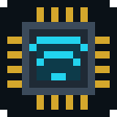

<p align="center">
  
</p>

<p align="center">
  
</p>

<p align="center">
  
  
  
  
</p>

A self-hosted, LAN-only control system for ESP32-based IoT devices: think "your own mini Home Assistant" scoped to ESP32 boards you build yourself, with a web dashboard, live telemetry, remote commands, simple automations, and an API for external agents and scripts.

## ✨ What it does

- **Register devices**: an ESP32 announces itself and its capabilities (the sensors it has, the commands it accepts) on boot, so there is no manual config on the server side.
- **Live dashboard**: every device's status, last heartbeat and sensor readings update in real time over WebSocket.
- **Remote control**: send commands (toggle a relay, move a slider, trigger a button) from the browser, with delivery and ack status shown live.
- **Automations**: simple threshold rules ("if temperature > 30°C, turn on the fan"), no visual programming, just dropdowns.
- **Logs**: per-device and cross-device log viewers backed by plain log files, with no external logging stack.
- **Agent API**: a separate API-key-authenticated namespace so a script, bot or LLM agent can read telemetry and issue commands alongside a human, with every action audited.
- **OTA updates**: push new firmware to a device over the air, with checksum verification.

## 🧱 How it's built

| Layer | Stack |
| --- | --- |
| Backend | Python: FastAPI + SQLAlchemy + SQLite, bridging REST/WebSocket to devices over MQTT |
| Frontend | React + TypeScript + Vite, plain CSS design tokens |
| Firmware | C++ for ESP32 (PlatformIO/Arduino): WiFi + MQTT + a pluggable per-board sensor/command config |
| Auth | One shared household password for the UI (session cookie), a separate device key for firmware, and per-agent API keys. No user accounts: it is designed for a single home/LAN, not multi-tenant use |

## 🚧 Status

Early / work in progress. The core device registry, auth, the frontend shell and the reference firmware are done and tested. Live telemetry streaming, command dispatch, automations and the full dashboard UI are still being built out. Not ready for production: expect rough edges and missing features.

## 🚀 Getting started

**Prerequisites:** Python 3.11+ and Node.js 18+ (npm). Optional: an ESP32 dev board, a USB cable and PlatformIO (`pip install platformio`) for the firmware, and an MQTT broker such as Mosquitto once MQTT bridging lands (not required yet).

### 1. Get the code

```sh
git clone https://github.com/Nisith-Akain/ESP32-Control.git
cd ESP32-Control/esp32-control
```

### 2. Run the backend

```sh
cd backend
python3 -m venv .venv
source .venv/bin/activate        # Windows: .venv\Scripts\activate
pip install -r requirements.txt
```

Set these three environment variables. The server refuses to start unless all of them are set:

```sh
export UI_PASSWORD="choose-a-password"
export SESSION_SECRET="a-long-random-string"
export DEVICE_SHARED_KEY="a-shared-secret-for-your-esp32s"
```

```sh
uvicorn app.main:app --reload --host 0.0.0.0 --port 8000
```

On first boot it creates a SQLite DB and a `data/nas/{logs,firmware,config}` directory tree.

### 3. Run the frontend

In a second terminal:

```sh
cd frontend
npm install
BACKEND_ORIGIN=http://localhost:8000 npm run dev
```

Open <http://localhost:5173> and log in with the `UI_PASSWORD` you set above.

No backend yet? Run `npm run mock:server` in one terminal and `npm run dev` in another to try the login flow against a fake backend.

### 4. Flash an ESP32 (needs real hardware)

```sh
cd firmware
cp include/config.example.h include/config.h
# edit config.h: WiFi SSID/password, backend URL and DEVICE_SHARED_KEY
# (it must match the backend's DEVICE_SHARED_KEY exactly)

pio run                     # compile
pio run --target upload     # flash over USB
pio device monitor          # watch serial logs at 115200 baud
```

The reference build has one placeholder sensor (`temp_c`, read off an ADC pin) and one command (`relay1`, drives a GPIO pin), enough to prove the pipeline works. Real sensors and commands go in `firmware/src/board_config.cpp`.

### 5. What you can do right now

- Log into the web UI with the shared password.
- Register a device by booting the firmware, which calls the backend automatically, or hit the endpoint directly:

```sh
curl -X POST http://localhost:8000/api/devices/register \
  -H "X-Device-Key: <your DEVICE_SHARED_KEY>" \
  -H "Content-Type: application/json" \
  -d '{"device_id":"esp32-abc123","capabilities":{"sensors":[...],"commands":[...]}}'

curl http://localhost:8000/api/devices -b cookies.txt   # after logging in via /api/auth/login
```

## 📄 License

See [LICENSE](LICENSE).
